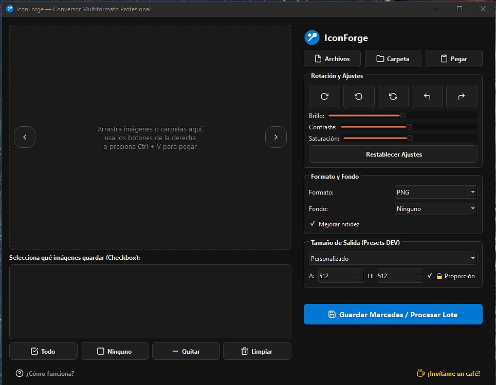

# 🛠️ IconForge — Batch Image Converter & Asset Generator

**IconForge** es una aplicación de escritorio moderna, ligera y portable construida con **Python** y **PySide6 (Qt6)**[cite: 3]. Diseñada específicamente para desarrolladores web, diseñadores y creadores de contenido, permite procesar, convertir, editar y redimensionar lotes de imágenes o vectores de forma rápida e intuitiva[cite: 3].

---

## ✨ Características Principales

- 🔄 **Procesamiento en Lote Inteligente:** Convierte archivos seleccionados o carpetas completas de manera simultánea[cite: 3]. Permite marcar/desmarcar imágenes individualmente mediante casillas (*checkboxes*)[cite: 3].
- 🎨 **Compatibilidad Multiformato Profesional:** 
  - **Soporte de Carga:** `PNG`, `JPG`, `WEBP`, `AVIF`, `HEIC / HEIF` (fotografías de iPhone/Android), `SVG` (vectores renderizados en alta resolución), `TIFF`, `BMP`, `ICO`, `ICNS`, `CUR`, `GIF`, `TGA`, `EPS`, `DDS`, `PBM`, `PGM`, `PPM`.
  - **Formatos de Salida:** `PNG`, `ICO`, `WEBP`, `AVIF`, `JPG`, `PDF`, `ICNS` (macOS), `TIFF`, `BMP`, `TGA`.
- 🌓 **Tema Adaptativo Dinámico:** Detecta automáticamente el modo claro u oscuro de tu sistema operativo (Windows/macOS/Linux), adaptando la paleta de colores de la interfaz y recoloreando los íconos para mantener máxima legibilidad[cite: 3].
- 📐 **Presets para Desarrolladores (DEV):** Dimensiones rápidas prediseñadas para:[cite: 3]
  - Favicon Web (16x16 / 32x32)[cite: 3]
  - Ícono de Escritorio / App (64x64 / 256x256)[cite: 3]
  - Apple Touch Icon iOS (180x180)[cite: 3]
  - Android PWA Standard & Large (192x192 / 512x512)[cite: 3]
  - Social Open Graph Cards (1200x630)[cite: 3]
- 📦 **ICO Multicapa Integrado:** Empaqueta contenedores `.ico` con múltiples tamaños embebidos (16px a 256px) ideales para aplicaciones de escritorio[cite: 3].
- ☀️ **Edición y Ajustes en Tiempo Real:** Rotaciones (90° izquierda/derecha, 180°), espejos (*flip* horizontal y vertical) y sliders para **Brillo**, **Contraste** y **Saturación**[cite: 3].
- ✂️ **Remoción de Fondo:** Transparencia instantánea para fondos blancos sencillos o remoción inteligente con Inteligencia Artificial utilizando la librería `rembg`[cite: 3].
- 📋 **Portapapeles Dinámico:** Pega imágenes o capturas de pantalla directamente en la aplicación con la combinación de teclas `Ctrl + V`[cite: 3].

---

## 🚀 Instalación y Uso

### Opción A: Ejecutable Portable (Sin Instalación)
1. Descarga la última versión del archivo `IconForge.exe` desde la sección de **Releases**[cite: 3].
2. Ejecuta el archivo `.exe` en tu sistema operativo Windows (no requiere dependencias adicionales ni instalación de Python)[cite: 3].
3. Arrastra tus archivos o carpetas, configura las opciones de salida y haz clic en **Guardar Marcadas / Procesar Lote**[cite: 3].

### Opción B: Ejecución desde Código Fuente (Python)
Requisitos previos: tener Python instalado en tu entorno[cite: 3].

```bash
# Clonar el repositorio o descargar el proyecto
git clone [https://github.com/tu-usuario/iconforge.git](https://github.com/tu-usuario/iconforge.git)
cd iconforge

# Instalar dependencias necesarias
pip install PySide6 Pillow rembg pillow-heif pillow-avif-plugin pyinstaller pyarmor

# Ejecutar la aplicación
python app_conversor.py

## Interfaz del Programa

